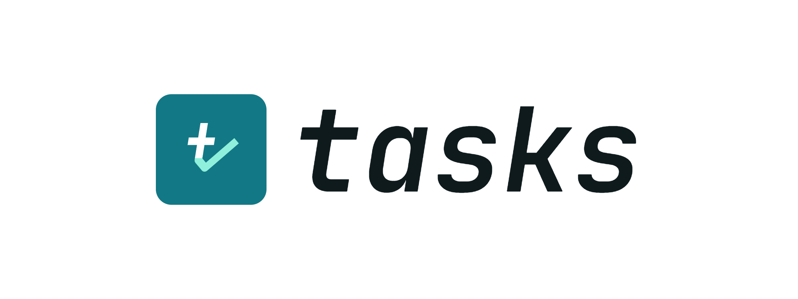

<p align="center">
  
</p>

<p align="center">
  <a href="https://go.dev"></a>
  <a href="https://wails.io"></a>
  <a href="https://sqlite.org"></a>
  
</p>

<p align="center">A kanban board that runs on your desktop and stores everything in one SQLite file.</p>

## Features

- Four columns: Backlog, Doing, Blocked, Done
- Projects, with an all-projects view
- Type (feature, bug, task) and priority filters
- Due dates, with overdue and due-today states
- Detail drawer for description, status, type, priority, due date and project
- Drag and drop between columns
- Single-field composer: type a title, press Enter, the drawer opens
- Keyboard shortcuts throughout; press `?` in the app for the list
- Light and dark themes, following the OS until you choose
- Resizable, collapsible columns and interface zoom

## Stack

Go and [Wails v2](https://wails.io) for the window and the backend, SQLite through [modernc.org/sqlite](https://gitlab.com/cznic/sqlite) so nothing needs cgo, and plain JavaScript with Vite for the UI. Inter is bundled, not fetched.

## Run

Requires Go 1.27+, Node 20.19+, and the Wails CLI:

```bash
go install github.com/wailsapp/wails/v2/cmd/wails@latest
```

On Debian or Ubuntu the webview headers are needed too:

```bash
sudo apt install libgtk-3-dev libwebkit2gtk-4.1-dev
```

Then:

```bash
wails dev                                  # live reload
wails build                                # current platform → build/bin/
wails build -platform windows/amd64        # cross-compile, no C toolchain required
```

A bare `go build ./...` only works after `npm run build`, because `frontend/dist` is embedded into the binary.

## Data

The board is a single file, `Tracker.db`, next to the binary: the repository root under `wails dev`, `build/bin/` for a built app. It is plain SQLite, so `sqlite3 Tracker.db .dump` is a full backup. Nothing is sent anywhere.

## Layout

```
main.go            window, embedding, startup
app.go             methods exposed to JavaScript
store/             schema, models, queries
frontend/
  index.html       markup
  src/main.js      application logic
  src/style.css    tokens and layout
  src/assets/      Inter
build/             icon, manifests, installer scripts
```

`frontend/wailsjs/` holds the generated bindings and is refreshed by `wails dev` and `wails build`.
